# TukodTrack ERD and data dictionary

Generated from the migrated schema. SQL types reflect the documentation database driver; migration precision remains authoritative for PostgreSQL decimals. Each diagram shows one table and its direct parent relationships. Nullable foreign keys allow zero or one parent; nonnullable keys require one. Children are zero-to-many.

## Contents
- [activity_logs](#activity_logs)
- [cache](#cache)
- [cache_locks](#cache_locks)
- [categories](#categories)
- [deliveries](#deliveries)
- [delivery_items](#delivery_items)
- [failed_jobs](#failed_jobs)
- [job_batches](#job_batches)
- [jobs](#jobs)
- [migrations](#migrations)
- [password_reset_tokens](#password_reset_tokens)
- [products](#products)
- [purchase_items](#purchase_items)
- [purchases](#purchases)
- [roles](#roles)
- [sale_items](#sale_items)
- [sales](#sales)
- [sessions](#sessions)
- [settings](#settings)
- [stock_adjustments](#stock_adjustments)
- [stock_movements](#stock_movements)
- [suppliers](#suppliers)
- [users](#users)

## activity_logs

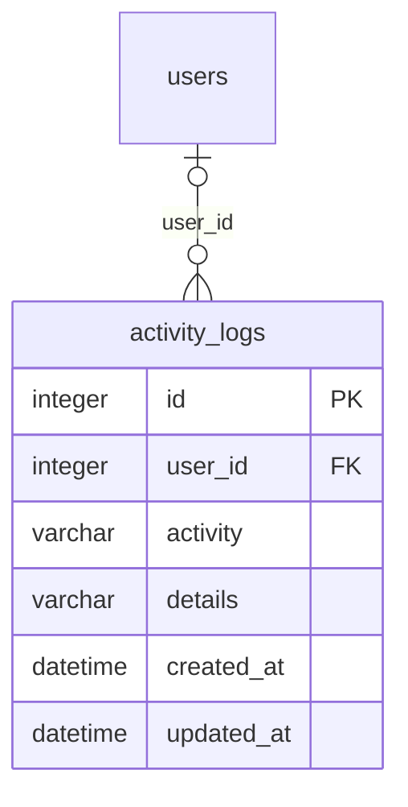

| Column | Type | Nullable | Default |
| --- | --- | --- | --- |
| id | integer | No | — |
| user_id | integer | Yes | — |
| activity | varchar | No | — |
| details | varchar | Yes | — |
| created_at | datetime | Yes | — |
| updated_at | datetime | Yes | — |

| Foreign key | References | Delete behavior |
| --- | --- | --- |
| user_id | users(id) | set null |

Indexes: primary (id) UNIQUE.

## cache

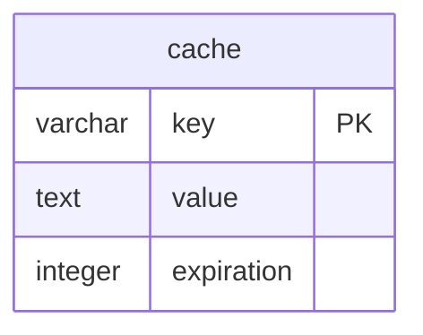

| Column | Type | Nullable | Default |
| --- | --- | --- | --- |
| key | varchar | No | — |
| value | text | No | — |
| expiration | integer | No | — |

Indexes: cache_expiration_index (expiration); sqlite_autoindex_cache_1 (key) UNIQUE.

## cache_locks

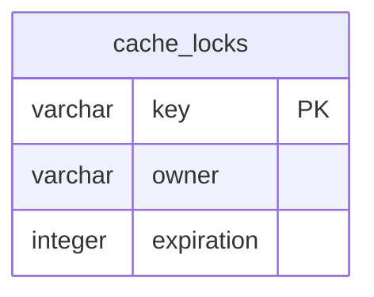

| Column | Type | Nullable | Default |
| --- | --- | --- | --- |
| key | varchar | No | — |
| owner | varchar | No | — |
| expiration | integer | No | — |

Indexes: cache_locks_expiration_index (expiration); sqlite_autoindex_cache_locks_1 (key) UNIQUE.

## categories

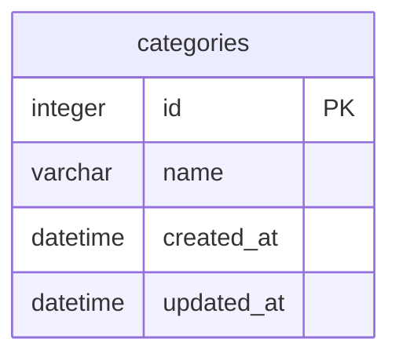

| Column | Type | Nullable | Default |
| --- | --- | --- | --- |
| id | integer | No | — |
| name | varchar | No | — |
| created_at | datetime | Yes | — |
| updated_at | datetime | Yes | — |

Indexes: categories_name_unique (name) UNIQUE; primary (id) UNIQUE.

## deliveries

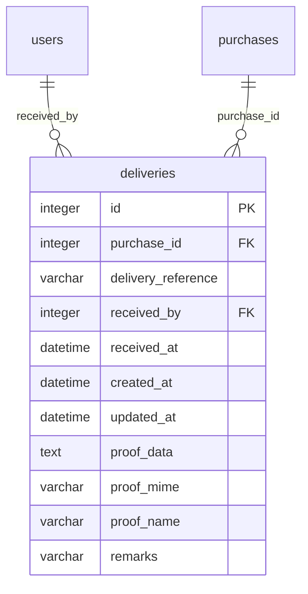

| Column | Type | Nullable | Default |
| --- | --- | --- | --- |
| id | integer | No | — |
| purchase_id | integer | No | — |
| delivery_reference | varchar | Yes | — |
| received_by | integer | No | — |
| received_at | datetime | No | — |
| created_at | datetime | Yes | — |
| updated_at | datetime | Yes | — |
| proof_data | text | Yes | — |
| proof_mime | varchar | Yes | — |
| proof_name | varchar | Yes | — |
| remarks | varchar | Yes | — |

| Foreign key | References | Delete behavior |
| --- | --- | --- |
| received_by | users(id) | no action |
| purchase_id | purchases(id) | no action |

Indexes: primary (id) UNIQUE.

## delivery_items

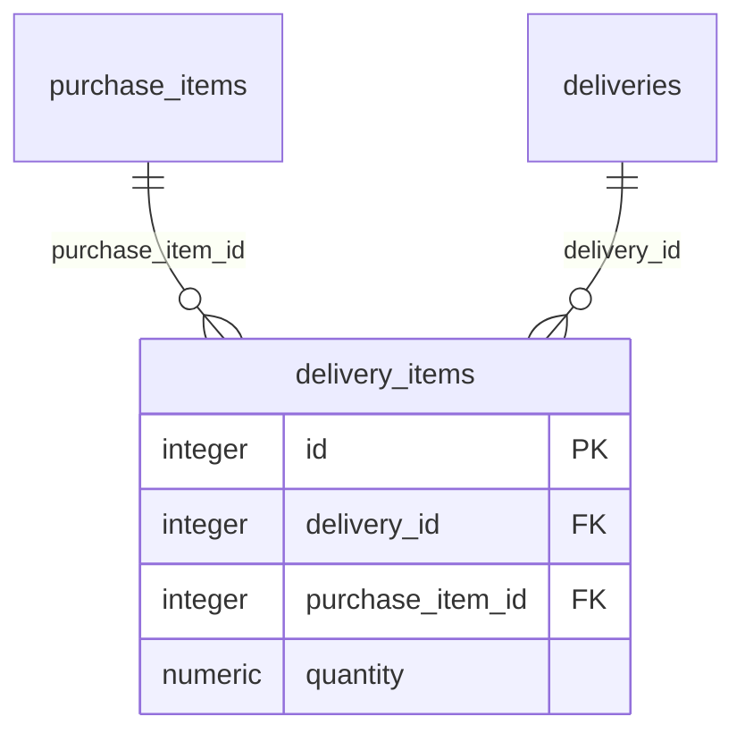

| Column | Type | Nullable | Default |
| --- | --- | --- | --- |
| id | integer | No | — |
| delivery_id | integer | No | — |
| purchase_item_id | integer | No | — |
| quantity | numeric | No | — |

| Foreign key | References | Delete behavior |
| --- | --- | --- |
| purchase_item_id | purchase_items(id) | no action |
| delivery_id | deliveries(id) | cascade |

Indexes: primary (id) UNIQUE.

## failed_jobs

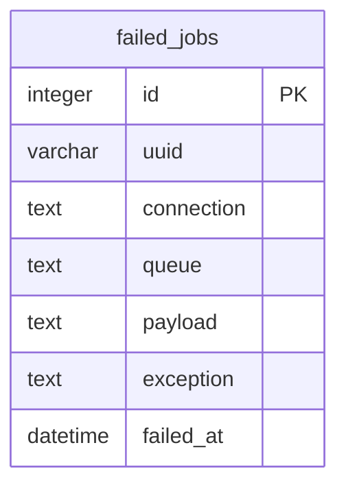

| Column | Type | Nullable | Default |
| --- | --- | --- | --- |
| id | integer | No | — |
| uuid | varchar | No | — |
| connection | text | No | — |
| queue | text | No | — |
| payload | text | No | — |
| exception | text | No | — |
| failed_at | datetime | No | CURRENT_TIMESTAMP |

Indexes: failed_jobs_uuid_unique (uuid) UNIQUE; primary (id) UNIQUE.

## job_batches

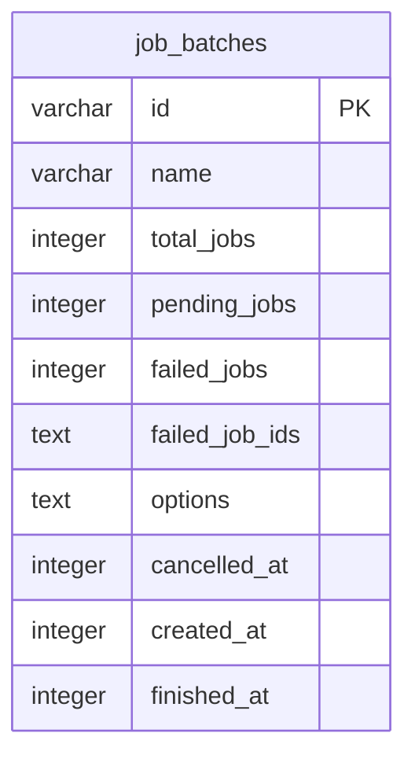

| Column | Type | Nullable | Default |
| --- | --- | --- | --- |
| id | varchar | No | — |
| name | varchar | No | — |
| total_jobs | integer | No | — |
| pending_jobs | integer | No | — |
| failed_jobs | integer | No | — |
| failed_job_ids | text | No | — |
| options | text | Yes | — |
| cancelled_at | integer | Yes | — |
| created_at | integer | No | — |
| finished_at | integer | Yes | — |

Indexes: sqlite_autoindex_job_batches_1 (id) UNIQUE.

## jobs

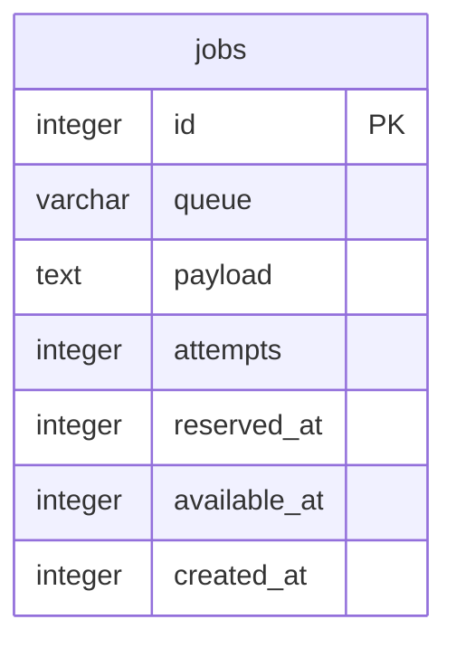

| Column | Type | Nullable | Default |
| --- | --- | --- | --- |
| id | integer | No | — |
| queue | varchar | No | — |
| payload | text | No | — |
| attempts | integer | No | — |
| reserved_at | integer | Yes | — |
| available_at | integer | No | — |
| created_at | integer | No | — |

Indexes: jobs_queue_index (queue); primary (id) UNIQUE.

## migrations

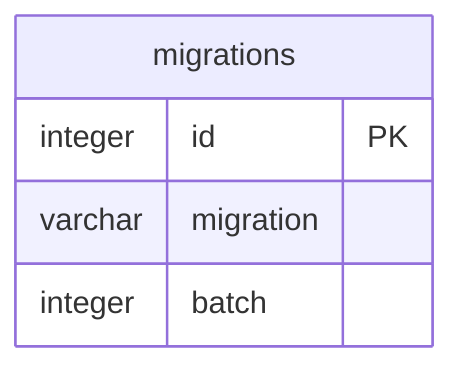

| Column | Type | Nullable | Default |
| --- | --- | --- | --- |
| id | integer | No | — |
| migration | varchar | No | — |
| batch | integer | No | — |

Indexes: primary (id) UNIQUE.

## password_reset_tokens

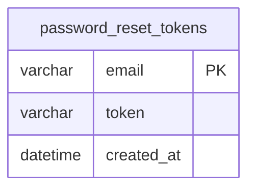

| Column | Type | Nullable | Default |
| --- | --- | --- | --- |
| email | varchar | No | — |
| token | varchar | No | — |
| created_at | datetime | Yes | — |

Indexes: sqlite_autoindex_password_reset_tokens_1 (email) UNIQUE.

## products

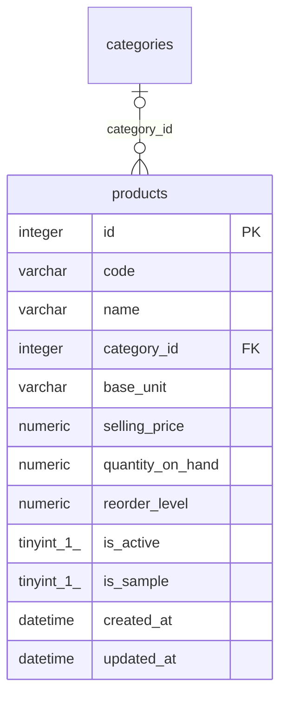

| Column | Type | Nullable | Default |
| --- | --- | --- | --- |
| id | integer | No | — |
| code | varchar | No | — |
| name | varchar | No | — |
| category_id | integer | Yes | — |
| base_unit | varchar | No | 'piece' |
| selling_price | numeric | No | '0' |
| quantity_on_hand | numeric | No | '0' |
| reorder_level | numeric | No | '0' |
| is_active | tinyint(1) | No | '1' |
| is_sample | tinyint(1) | No | '0' |
| created_at | datetime | Yes | — |
| updated_at | datetime | Yes | — |

| Foreign key | References | Delete behavior |
| --- | --- | --- |
| category_id | categories(id) | set null |

Indexes: primary (id) UNIQUE; products_code_unique (code) UNIQUE.

## purchase_items

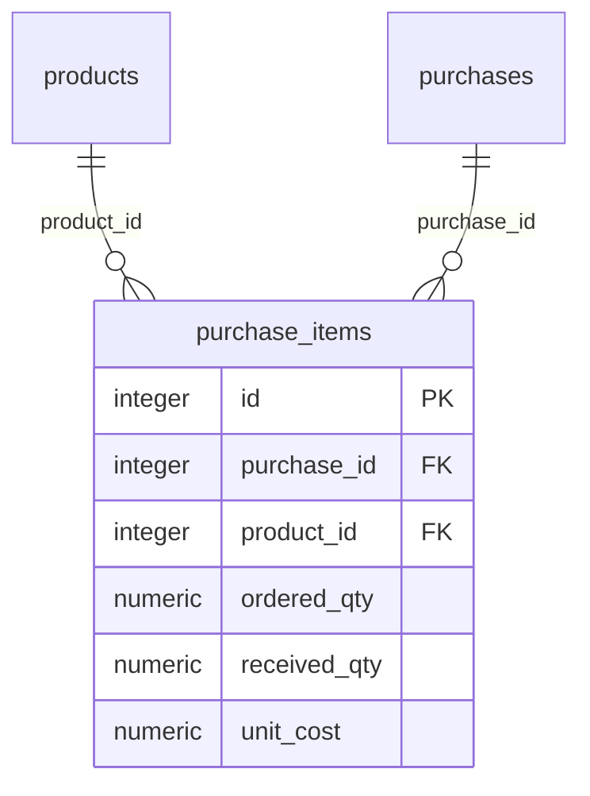

| Column | Type | Nullable | Default |
| --- | --- | --- | --- |
| id | integer | No | — |
| purchase_id | integer | No | — |
| product_id | integer | No | — |
| ordered_qty | numeric | No | — |
| received_qty | numeric | No | '0' |
| unit_cost | numeric | No | '0' |

| Foreign key | References | Delete behavior |
| --- | --- | --- |
| product_id | products(id) | no action |
| purchase_id | purchases(id) | cascade |

Indexes: primary (id) UNIQUE.

## purchases

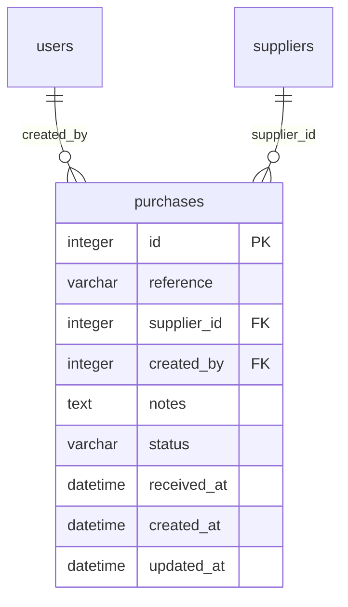

| Column | Type | Nullable | Default |
| --- | --- | --- | --- |
| id | integer | No | — |
| reference | varchar | Yes | — |
| supplier_id | integer | No | — |
| created_by | integer | No | — |
| notes | text | Yes | — |
| status | varchar | No | 'pending' |
| received_at | datetime | Yes | — |
| created_at | datetime | Yes | — |
| updated_at | datetime | Yes | — |

| Foreign key | References | Delete behavior |
| --- | --- | --- |
| created_by | users(id) | no action |
| supplier_id | suppliers(id) | no action |

Indexes: primary (id) UNIQUE; purchases_reference_unique (reference) UNIQUE.

## roles

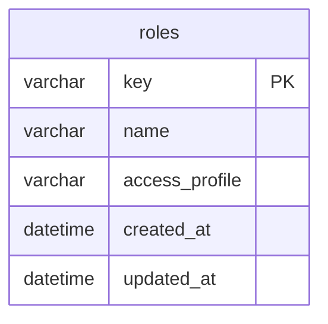

| Column | Type | Nullable | Default |
| --- | --- | --- | --- |
| key | varchar | No | — |
| name | varchar | No | — |
| access_profile | varchar | No | — |
| created_at | datetime | Yes | — |
| updated_at | datetime | Yes | — |

Indexes: roles_name_unique (name) UNIQUE; sqlite_autoindex_roles_1 (key) UNIQUE.

## sale_items

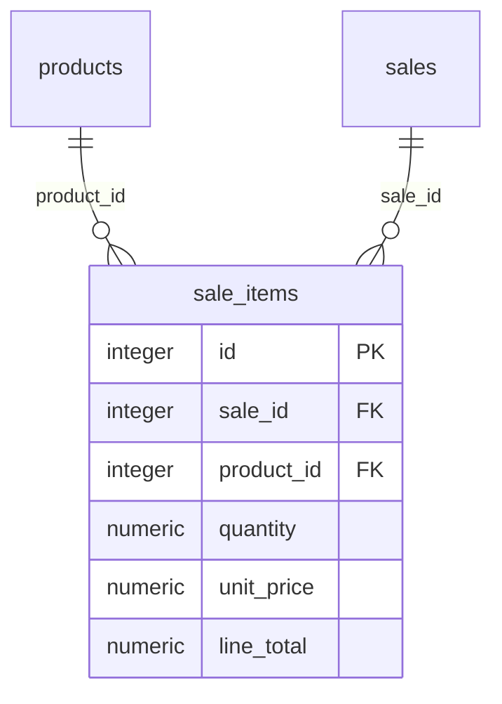

| Column | Type | Nullable | Default |
| --- | --- | --- | --- |
| id | integer | No | — |
| sale_id | integer | No | — |
| product_id | integer | No | — |
| quantity | numeric | No | — |
| unit_price | numeric | No | — |
| line_total | numeric | No | — |

| Foreign key | References | Delete behavior |
| --- | --- | --- |
| product_id | products(id) | no action |
| sale_id | sales(id) | cascade |

Indexes: primary (id) UNIQUE.

## sales

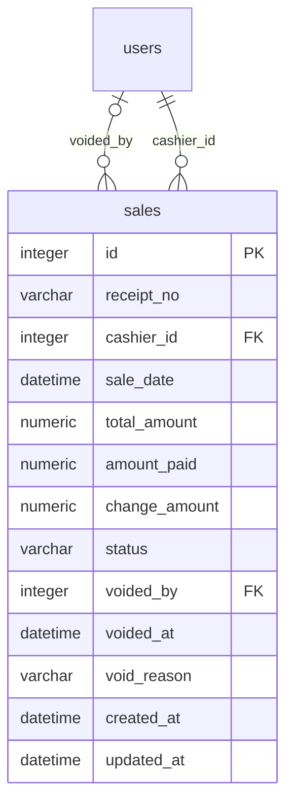

| Column | Type | Nullable | Default |
| --- | --- | --- | --- |
| id | integer | No | — |
| receipt_no | varchar | Yes | — |
| cashier_id | integer | No | — |
| sale_date | datetime | No | — |
| total_amount | numeric | No | '0' |
| amount_paid | numeric | No | '0' |
| change_amount | numeric | No | '0' |
| status | varchar | No | 'completed' |
| voided_by | integer | Yes | — |
| voided_at | datetime | Yes | — |
| void_reason | varchar | Yes | — |
| created_at | datetime | Yes | — |
| updated_at | datetime | Yes | — |

| Foreign key | References | Delete behavior |
| --- | --- | --- |
| voided_by | users(id) | no action |
| cashier_id | users(id) | no action |

Indexes: primary (id) UNIQUE; sales_receipt_no_unique (receipt_no) UNIQUE.

## sessions

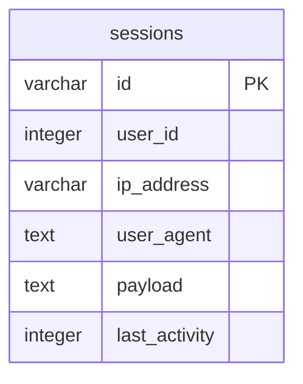

| Column | Type | Nullable | Default |
| --- | --- | --- | --- |
| id | varchar | No | — |
| user_id | integer | Yes | — |
| ip_address | varchar | Yes | — |
| user_agent | text | Yes | — |
| payload | text | No | — |
| last_activity | integer | No | — |

Indexes: sessions_last_activity_index (last_activity); sessions_user_id_index (user_id); sqlite_autoindex_sessions_1 (id) UNIQUE.

## settings

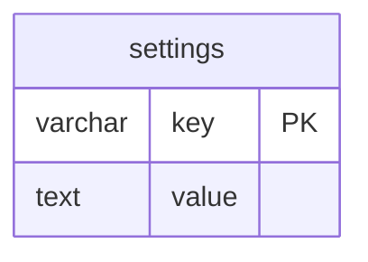

| Column | Type | Nullable | Default |
| --- | --- | --- | --- |
| key | varchar | No | — |
| value | text | Yes | — |

Indexes: sqlite_autoindex_settings_1 (key) UNIQUE.

## stock_adjustments

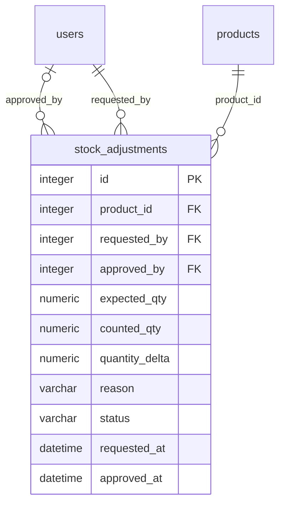

| Column | Type | Nullable | Default |
| --- | --- | --- | --- |
| id | integer | No | — |
| product_id | integer | No | — |
| requested_by | integer | No | — |
| approved_by | integer | Yes | — |
| expected_qty | numeric | No | — |
| counted_qty | numeric | No | — |
| quantity_delta | numeric | No | — |
| reason | varchar | Yes | — |
| status | varchar | No | 'pending' |
| requested_at | datetime | No | — |
| approved_at | datetime | Yes | — |

| Foreign key | References | Delete behavior |
| --- | --- | --- |
| approved_by | users(id) | no action |
| requested_by | users(id) | no action |
| product_id | products(id) | no action |

Indexes: primary (id) UNIQUE.

## stock_movements

```mermaid
erDiagram
    direction TB
    stock_movements {
        integer id PK
        integer product_id FK
        integer recorded_by FK
        varchar movement_type
        numeric quantity_delta
        integer purchase_item_id FK
        integer delivery_item_id FK
        integer sale_item_id FK
        integer adjustment_id FK
        integer reverses_movement_id
        varchar reference
        varchar reason
        datetime created_at
        datetime updated_at
    }
    stock_adjustments |o--o{ stock_movements : "adjustment_id"
    sale_items |o--o{ stock_movements : "sale_item_id"
    delivery_items |o--o{ stock_movements : "delivery_item_id"
    purchase_items |o--o{ stock_movements : "purchase_item_id"
```

```mermaid
erDiagram
    direction TB
    users ||--o{ stock_movements : "recorded_by"
    products ||--o{ stock_movements : "product_id"
```

| Column | Type | Nullable | Default |
| --- | --- | --- | --- |
| id | integer | No | — |
| product_id | integer | No | — |
| recorded_by | integer | No | — |
| movement_type | varchar | No | — |
| quantity_delta | numeric | No | — |
| purchase_item_id | integer | Yes | — |
| delivery_item_id | integer | Yes | — |
| sale_item_id | integer | Yes | — |
| adjustment_id | integer | Yes | — |
| reverses_movement_id | integer | Yes | — |
| reference | varchar | Yes | — |
| reason | varchar | Yes | — |
| created_at | datetime | Yes | — |
| updated_at | datetime | Yes | — |

| Foreign key | References | Delete behavior |
| --- | --- | --- |
| adjustment_id | stock_adjustments(id) | no action |
| sale_item_id | sale_items(id) | no action |
| delivery_item_id | delivery_items(id) | no action |
| purchase_item_id | purchase_items(id) | no action |
| recorded_by | users(id) | no action |
| product_id | products(id) | no action |

Indexes: primary (id) UNIQUE.

## suppliers

```mermaid
erDiagram
    direction TB
    suppliers {
        integer id PK
        varchar name
        varchar contact_person
        varchar phone
        varchar email
        varchar address
        tinyint_1_ is_active
        tinyint_1_ is_sample
        datetime created_at
        datetime updated_at
    }
```

| Column | Type | Nullable | Default |
| --- | --- | --- | --- |
| id | integer | No | — |
| name | varchar | No | — |
| contact_person | varchar | Yes | — |
| phone | varchar | Yes | — |
| email | varchar | Yes | — |
| address | varchar | Yes | — |
| is_active | tinyint(1) | No | '1' |
| is_sample | tinyint(1) | No | '0' |
| created_at | datetime | Yes | — |
| updated_at | datetime | Yes | — |

Indexes: primary (id) UNIQUE.

## users

```mermaid
erDiagram
    direction TB
    users {
        integer id PK
        varchar name
        varchar email
        datetime email_verified_at
        varchar password
        varchar remember_token
        datetime created_at
        datetime updated_at
        varchar role FK
        tinyint_1_ is_active
        tinyint_1_ must_change_password
    }
    roles ||--o{ users : "role"
```

| Column | Type | Nullable | Default |
| --- | --- | --- | --- |
| id | integer | No | — |
| name | varchar | No | — |
| email | varchar | No | — |
| email_verified_at | datetime | Yes | — |
| password | varchar | No | — |
| remember_token | varchar | Yes | — |
| created_at | datetime | Yes | — |
| updated_at | datetime | Yes | — |
| role | varchar | No | 'cashier' |
| is_active | tinyint(1) | No | '1' |
| must_change_password | tinyint(1) | No | '0' |

| Foreign key | References | Delete behavior |
| --- | --- | --- |
| role | roles(key) | no action |

Indexes: primary (id) UNIQUE; users_email_unique (email) UNIQUE.

## Logical references without database foreign keys

- stock_movements.reverses_movement_id refers to stock_movements.id; the original schema does not enforce a self-foreign-key.
- sessions.user_id is indexed but has no enforced foreign key.
- password_reset_tokens.email is the Laravel reset-token lookup key, not an enforced users.email foreign key.
- settings, cache and queue tables are independent framework/application storage.
