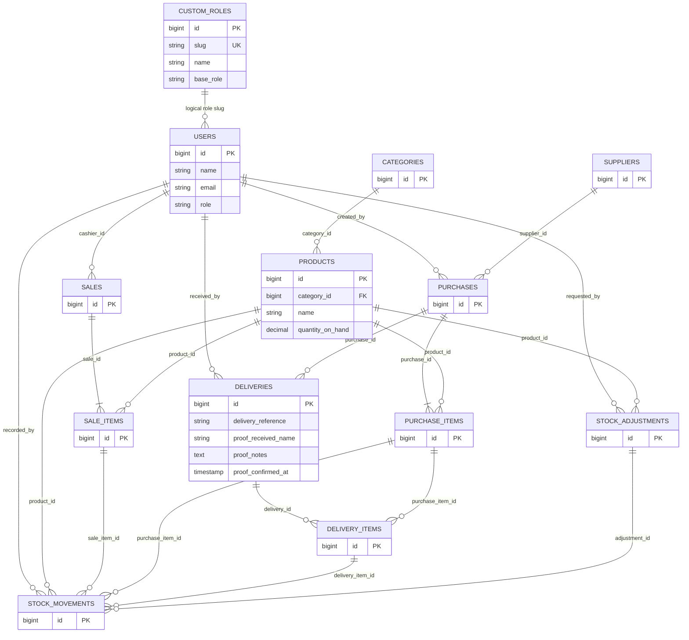

# TukodTrack Entity Relationship Diagram (revision working diagram)

This diagram summarizes relationships exposed by the current application models and new revision migration. Before submission, compare every field and FK with the actual PostgreSQL schema (Neon SQL Editor) and the remaining Laravel migrations; it is not a certified full schema extract.

**Caution:** The custom role association uses a role slug string rather than a database foreign key. Delivery proof fields record a staff acknowledgement, not a photo or handwritten signature.
